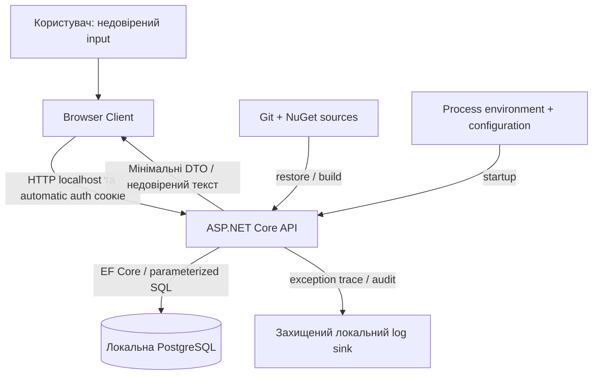

# Модель загроз SecureLab, ЛР 6

Дата старту: 02.11.2026. Оновлено після етапу 3: 09.11.2026. Цільовий рівень: **відмінний («Відмінно»)**.
Стан документа: актуальний протокол — [етап 3](lab-06-stage3.md); CP-04 release ще попереду.

## Відтворюваний старт

- Review-start commit: `ee18ff404459584030df429c6a2c899c64cda89d`.
- Гілка: `lab/6-hardening-review`.
- Власний `v0.5.0`: `6deee13efdb487a0fa0cb611b15e282e0b6a7100`.
- Гілку створено від поточного cumulative HEAD: `src`, `infra`, `global.json` та
  `Directory.Build.props` на review-start не мали diff проти `v0.5.0`; пізніші виправлення
  документації збережено. Попередній тег не переміщено.
- На початку були 8 змінених tracked файлів і 15 untracked записів Git, зокрема
  матеріали ЛР 4–5 та `IncidentDecTests.cs`. Їх не відкидали й не включали до
  припущення про чистий release. HEAD не описує всі ці локальні матеріали.
- SDK `10.0.403`; `global.json`: `10.0.100`, `latestFeature`, без prerelease.
- PostgreSQL: сервіс наявного Compose, тільки `127.0.0.1:54329`, БД `securelab`.
- Перед тестами та після них штатний reset виконано в Development.
  Seed-пароль передано дочірнім процесам поза tracked Git state. Значення
  збережено лише в ігнорованому `tmp/lab06/local.runsettings` для локального повтору.
- Докази: [початковий Git state](evidence/lab06-start-state.json),
  [прогін етапу 1](evidence/lab06-stage1.json) та [етапу 2](evidence/lab06-stage2.json).

## Компоненти та середовища

| Компонент | Фактична реалізація | Межі огляду |
|---|---|---|
| Браузер | HTML/Vanilla JS у `src/SecureLab.Api/Client`; Chrome через Playwright | Development, HTTP localhost; вхід, профіль, F5, список, деталі, summary, marker як текст, logout |
| API | ASP.NET Core Minimal APIs, Identity cookie, централізовані `IncidentAccessRules` | Development та Production; JSON contracts, authorization, error pipeline |
| Дані | EF Core/Npgsql, PostgreSQL, Identity/domain tables | Власна локальна навчальна БД та штатний reset/seed |
| Репозиторій/build | Git, SDK policy, NuGet lockfiles | Поточні tracked текстові файли; locked restore і Release build |
| Конфігурація | appsettings, launch profile, Compose, process environment | Джерела connection string, reset/migration flags, cookie policy, AllowedHosts |
| Діагностика | Console scopes, ExceptionHandlerMiddleware, triage success/denial та session revocation audit | Шість класів сценаріїв, повні normal/exception logs перевірено на точні sensitive values; безпечні excerpts і trace correlation у CP-03 |

Redis, reverse proxy та production host у фактичній конфігурації відсутні.

## Суб’єкти та активи

| Суб’єкт | Фактичні права |
|---|---|
| Anonymous | register/login, статичний клієнт, health; protected API повертає 401 |
| Reporter (Alice, Bob) | Створення; читання, зміна content і видалення власних інцидентів; чужі приховано через 404 |
| Analyst (Morgan) | Створення, читання всіх інцидентів та internal comments; `New → Triaged`; без update content/delete |
| Administrator | Немає автоматичних прав на Incident; операції відхиляються за поточною матрицею |
| Локальний розробник | Доступ до коду, process configuration, локальної БД та діагностичних журналів |

Активи: пароль і password hash користувача; authentication cookie; приватні
інциденти та internal comments; цілісність owner/content/status; право привілейованого
переходу; історія статусів та audit events; доступність API/БД; секрети конфігурації.
Password hash не є відкритим паролем, але також потребує захисту.

## Точки входу

Authenticated GET `/api/auth/csrf`: standard GetAndStoreTokens, no-store, CORS disabled.
Unsafe routes і рішення для login/register узгоджено в [perimeter етапу 2](lab-06-stage2.md).
Етап 3 додає шосту захищену cookie mutation; актуальна таблиця — [CP-03](lab-06-stage3.md), OpenAPI perimeter — `checks.csrf-perimeter`.

| Method + route / інший вхід | Дані або дія | Наявний контроль / відомий gap |
|---|---|---|
| POST `/api/auth/register` | Створення account | Валідація, Identity, серверна Reporter role; окреме CSRF scope-рішення на етапі 2 |
| POST `/api/auth/login` | Створення cookie-сеансу | Identity, generic failure, IP limiter; anonymous login-CSRF exception і ризик явно описані в етапі 2 |
| POST `/api/me/sessions/revoke-all` | Відкликання всіх власних сеансів | Authenticated principal, strict DTO без target user, standard antiforgery, повторний CheckPasswordAsync, атомарний ліміт 5/2 хв, audit; stamp rotation + SignOut |
| POST `/api/auth/logout` | Завершення cookie-сеансу | SignOut; standard explicit antiforgery перед SignOut |
| GET `/api/me`, `/api/auth/session-check` | Перевірений principal / профіль | RequireAuthorization, мінімальний DTO |
| GET `/api/incidents`, `/{id}`, `/search`, `/severity-summary` | Фільтри, q/sortBy, GUID | Cookie, роль/owner, LINQ, allowlist sort; search limiter 30/10 за verified principal |
| POST `/api/incidents` | Створення Incident | Роль, validation, owner із principal; explicit standard AntiforgeryFilter |
| PUT `/api/incidents/{id}` | Зміна title/description | Reporter owner, відмова для protected JSON fields; explicit standard AntiforgeryFilter |
| DELETE `/api/incidents/{id}` | Видалення Incident | Reporter owner; explicit standard AntiforgeryFilter |
| POST `/api/incidents/{id}/triage` | Перехід `New → Triaged` | Analyst + стан ресурсу, history, audit deny; explicit standard AntiforgeryFilter |
| GET `/api/incident-comments/{id}` | Child read | Parent ownership та internal visibility |
| GET `/health`; static files; Development OpenAPI/Scalar | Readiness, ресурси клієнта, схема API | Health не повертає connection string; OpenAPI/Scalar реєструються лише в Development |
| Environment / appsettings / Compose | Конфігурація при старті | Production вимагає явного connection string; reset заборонено |
| Git / NuGet restore | Код і залежності | Lockfiles, locked restore; dependency advisory audit належить етапу 3 |
| Console / audit sink | Внутрішня діагностика | Мінімальний доказ через trace; raw logs не входять до evidence |

## Схема меж довіри

## Актив → загроза → контроль → перевірка

| Межа / актив | Загроза | Наявний або потрібний контроль | Конкретна перевірка | Статус після етапу 2 |
|---|---|---|---|---|
| Browser → API / cookie-сеанс | Підроблена identity через client header | Identity principal, RequireAuthorization | `CurrentUserEndpointTests.Me_WithoutCookie_Returns401ProblemWithoutRedirectOrChallenge` | PASS у поточному прогоні 123 тестів |
| Browser → API / власні дані | IDOR, підміна owner | IncidentAccessRules; owner із principal | `IncidentAuthorizationTests.Details_EnforcesAuthenticationOwnershipAndAnalystReadContract`, `IncidentOwnershipSecurityTests.Create_WithForeignOwnerUserId_IgnoresItAndUsesAuthenticatedPrincipal` | PASS |
| Browser → API / цілісність запису | CSRF з automatic cookie | Standard antiforgery на всьому cookie mutation perimeter | `REG-CSRF-01`: відмова + незмінність + valid-token success, увесь perimeter | PASS, етап 2 |
| API → PostgreSQL / дані та SQL | SQLi через q/sortBy | LINQ parameters, ILike escaping, allowlist sort | `SearchMechanicsTests.Search_WithControlledReadOnlyInput_ReturnsNoMatches`, `Search_WithUnsupportedSortBy_Returns400ProblemDetails` | PASS |
| API → DOM / браузер користувача | Stored XSS | textContent/createTextNode, CSP | `IncidentEndpointTests.ClientScript_DoesNotUseDangerousInnerHtmlSink`; Chrome flow `browser-before`/`browser-restored`: marker literal, execution=false | PASS у перевірених сценаріях; не повний pack ЛР 6 |
| Cookie → API / конфіденційність сеансу | Небезпечні cookie attributes | Production Secure.Always, HttpOnly, SameSite=Lax | `ProductionProfileTests.Production_AuthenticationCookieRetainsSecureHttpOnlyAndSameSiteFlags` | PASS у HTTPS-addressed TestServer; реальний TLS не перевірявся |
| Repository → build / конфігураційні credentials | Потрапляння реального секрету до tracked state | env, .gitignore, класифікація study-only values | `git grep` snapshot: 514 збігів, окремі рішення CSV; `git check-ignore`; locked restore | Перевірено в описаних межах |
| Environment → API / стан БД | Development config або reset у Production | Явна конфігурація, Development guard | `ProductionProfileTests.Production_UsesExplicitConfigurationAndPreservesProtectedErrorContracts`, `ProductionReset_IsRejectedWithoutChangingStudyRows`; console refusal | PASS |
| API → client / внутрішні відомості | Витік stack trace, SQL, secrets | AddProblemDetails + UseExceptionHandler | `UnexpectedDatabaseFailure_ReturnsSafeProblemLinkedToExceptionLog`; фактичний Production login до недоступної локальної БД | PASS: 500, без внутрішніх деталей, trace пов’язано |
| API → logs / діагностика та credentials | Витік credentials / втрата кореляції | Console scopes, minimal allowlisted audit; без body/header dumps | CP-03: повні original logs шести класів сценаріїв, exact sensitive values/pattern scans, matching response/log trace | 0 збігів у normal та Production exception logs; whitelist audit fields збережено |
| Browser → Identity / усі власні сеанси | Replay старої cookie після відкликання | UpdateSecurityStampAsync, ValidationInterval=0, SignOut поточного сеансу | `SessionRevocationTests`: два Alice + replay 401, Bob 200, новий login працює; Bob self-only | In-flight запити не скасовуються; додаткові DB reads/Set-Cookie виміряно |
| Browser → antiforgery / same-user stale token | Старий CSRF token проходить після нового входу того самого user | Global additional data прив’язано до digest userId/stamp із principal claims; anonymous явно оброблено | Before/after default provider 204 vs stamp-bound 400; fresh pair 204; anonymous round-trip | Same-origin XSS лишається поза гарантіями CSRF |
| Authenticated user → password check / CPU | Підбір повторного пароля / обхід квоти другим сеансом | Atomic admission 5/2 хв за verified subject, без persistent lockout | 5 failure 403 + наступний 429 без revoke; Bob незалежний; recovery; failure audit | In-memory quota одного процесу |
| Analyst → PostgreSQL / canonical workflow | Concurrent triage дублює одну подію в історії | Conditional atomic UPDATE + history в одній transaction; audit після commit | F-03: до 204+204/2 history; після 204+409/1 history, той самий 2-reader test barrier | Інші майбутні переходи та content concurrency потребують окремого огляду |
| API → ресурс / доступність | Зловживання login/search | LoginAttemptLimiter; search fixed-window limiter | `AuthenticationProtectionTests.Login_AfterMaximumFailedAttempts_Returns429AndRecoversAfterWindow`, `LoginAttemptLimiterTests.FailedAttempts_ArePartitionedAndExpireAtTheWindowBoundary`; `SearchRateLimitTests.Search_EnforcesQuotaIsolatesVerifiedSubjectsAndRecoversWithoutGrantingAccess` | Login і search PASS; actual 30/10 та два partitions/recovery |

## Виключення та залишкові ризики

- Лише власний локальний навчальний стенд зі штучними accounts/data. Зовнішні
  hosts, production deployment, TLS termination та non-loopback HSTS не тестувалися.
- HTTP localhost і TestServer з `https://localhost` не доводять шифрування
  реального з’єднання. У launchSettings є тільки HTTP; UseHsts/UseHttpsRedirection відсутні.
- `AllowedHosts="*"`: фільтрацію Host не налаштовано; локальний scope не є
  прийняттям такої конфігурації для реального deployment.
- CP-03 keyword/signature review охоплює current tracked text та окремо визначені
  planned-release untracked source/docs ЛР 6; кожен файл має hash у manifest.
  Binary DOCX/PDF, unrelated untracked resources, stash/clones/зовнішній CI та
  full history виключені. Окремий limited review трьох DB config history збережено.
- Dependency advisory result — point-in-time відповідь NuGet, не гарантія проти
  невідомих вразливостей. Повний CP-03 regression не замінює фінального CP-04 release run.
- Advanced variant погоджений у переданій користувачем відповіді викладача;
  дослівний текст збережено в evidence. Реалізація self-only без Redis.
